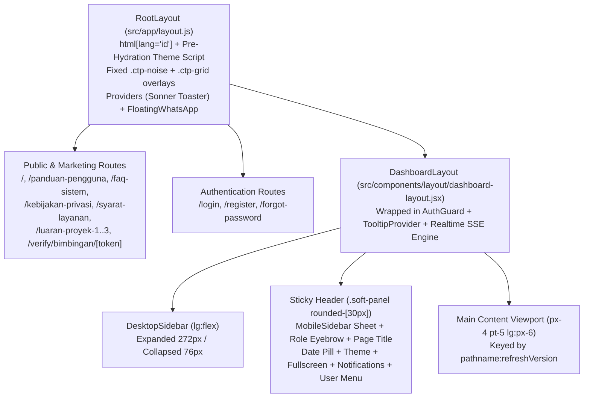

# Kavana Design System & UI/UX Architecture (`DESIGN.md`)

> **Product:** Kavana — Sistem Bimbingan Online Program Studi D4 Teknik Informatika ULBI  
> **Codebase Scope:** `Frontend-Kavana/src/app`, `Frontend-Kavana/src/components`, `Frontend-Kavana/src/lib`  
> **Tech Stack:** Next.js (App Router, React 19), Tailwind CSS v4 (`@theme inline`), Radix UI (`radix-ui`), Class Variance Authority (`cva`), Framer Motion, Recharts, Lucide React, Sonner

---

## Table of Contents

1. [Design Philosophy & Visual Identity](#1-design-philosophy--visual-identity)
2. [Design Tokens & Color System](#2-design-tokens--color-system)
3. [Typography, Spacing, Radius & Elevation](#3-typography-spacing-radius--elevation)
4. [Global Layout & Navigation Architecture](#4-global-layout--navigation-architecture)
5. [UI Component Catalog (Primitives & Shared Components)](#5-ui-component-catalog-primitives--shared-components)
6. [Domain-Specific Composite Patterns & Data Visualization](#6-domain-specific-composite-patterns--data-visualization)
7. [Complete Page-by-Page Design Specification](#7-complete-page-by-page-design-specification)
   - [7.1 Public & Marketing Pages](#71-public--marketing-pages)
   - [7.2 Authentication & Onboarding Pages](#72-authentication--onboarding-pages)
   - [7.3 Mahasiswa Dashboard & Workflows](#73-mahasiswa-dashboard--workflows)
   - [7.4 Dosen Pembimbing Dashboard & Workflows](#74-dosen-pembimbing-dashboard--workflows)
   - [7.5 Dosen Penguji Dashboard & Workflows](#75-dosen-penguji-dashboard--workflows)
   - [7.6 Koordinator Dashboard & Workflows](#76-koordinator-dashboard--workflows)
   - [7.7 Kepala Prodi (Kaprodi) Dashboard & Workflows](#77-kepala-prodi-kaprodi-dashboard--workflows)
   - [7.8 Administrator Dashboard & Workflows](#78-administrator-dashboard--workflows)
   - [7.9 Developer Center & Telemetry Console](#79-developer-center--telemetry-console)
   - [7.10 Shared Dashboard Pages](#710-shared-dashboard-pages)
8. [Role-Based Route Architecture & Re-Export Matrix](#8-role-based-route-architecture--re-export-matrix)
9. [Motion, Interaction & Accessibility Standards](#9-motion-interaction--accessibility-standards)

---

## 1. Design Philosophy & Visual Identity

Kavana is an integrated academic guidance, project/internship administration, and defense (`sidang`) management platform built for **Program Studi D4 Teknik Informatika — Universitas Logistik dan Bisnis Internasional (ULBI)**.

### Core Aesthetic Principles
1. **Corporate-Clean Academic Authority:** Uses a high-clarity **Slate + Royal Blue** palette mapped onto a structured `--ctp-*` (Catppuccin-inspired) token layer and `shadcn/ui` semantic variables. This allows public marketing pages, authentication flows, and dense multi-role academic dashboards to share a single unified token system.
2. **Soft Layered Surfaces (`Soft Panel` & `Soft Card`):** App surfaces sit atop a subtle mantle background (`--ctp-mantle`) with a fixed radial-masked 34×34px architectural grid (`.ctp-grid`) and vertical gradient wash (`.ctp-noise`). Elevated containers use translucent base fills, 1px `surface1` borders, and diffused sapphire-tinted shadows.
3. **Role-Scoped Clarity Across 7 Distinct Personas:** The interface adapts its navigation, KPI cards, status badges, and action tables to seven distinct roles: **Mahasiswa**, **Dosen Pembimbing**, **Dosen Penguji**, **Koordinator**, **Kepala Prodi (Kaprodi)**, **Administrator**, and **Developer**.
4. **Dual-Theme Parity (Light & Dark Mode):** Every component is token-driven via `hsl(var(--ctp-*))` and semantic CSS custom properties. A synchronous pre-hydration inline script in `src/app/layout.js` resolves `localStorage.getItem('kavana-theme')` (`light`, `dark`, or `system`) before first paint to prevent theme flash, while manual toggling applies a `240ms ease` cross-fade (`.theme-transition`).

---

## 2. Design Tokens & Color System

All color tokens are defined in `src/app/globals.css` as raw `H S% L%` triplets under `--ctp-*` and bridged into Tailwind CSS v4 via `@theme inline`.

### 2.1 Core Surface & Neutral Tokens

| Token | Role / Usage | Light Mode (`:root`) | Light Hex (Approx) | Dark Mode (`.dark`) | Dark Hex (Approx) |
| :--- | :--- | :--- | :--- | :--- | :--- |
| `--ctp-text` | Primary body & heading text | `222 47% 11%` | `#0F172A` (Slate 900) | `210 40% 98%` | `#F8FAFC` (Slate 50) |
| `--ctp-subtext1` | Secondary text, active labels, nav links | `215 19% 35%` | `#475569` (Slate 600) | `214 32% 82%` | `#CBD5E1` (Slate 300) |
| `--ctp-subtext0` | Muted text, descriptions, table headers, eyebrows | `215 16% 47%` | `#64748B` (Slate 500) | `215 20% 65%` | `#94A3B8` (Slate 400) |
| `--ctp-overlay2` | Scrollbar hover, strong muted icons | `215 16% 47%` | `#64748B` | `215 16% 57%` | `#8091A5` |
| `--ctp-overlay1` | Placeholders, subtle section labels, inactive icons | `215 20% 65%` | `#94A3B8` (Slate 400) | `215 19% 47%` | `#61738E` |
| `--ctp-overlay0` | Dashed empty state borders, subtle dividers | `213 27% 84%` | `#CBD5E1` (Slate 300) | `215 25% 33%` | `#3F5169` |
| `--ctp-surface2` | Secondary outline button borders | `213 27% 84%` | `#CBD5E1` (Slate 300) | `215 25% 33%` | `#3F5169` |
| `--ctp-surface1` | Default card/input/table/sidebar borders | `214 32% 91%` | `#E2E8F0` (Slate 200) | `215 28% 25%` | `#2E3D52` |
| `--ctp-surface0` | Muted fills, secondary buttons, stat card tint | `210 40% 96%` | `#F1F5F9` (Slate 100) | `217 33% 20%` | `#222F44` |
| `--ctp-base` | Primary card, modal, navbar & sidebar background | `0 0% 100%` | `#FFFFFF` (White) | `222 47% 11%` | `#0F172A` (Slate 900) |
| `--ctp-mantle` | Document `<body>` background & dark card surface | `210 40% 98%` | `#F8FAFC` (Slate 50) | `222 47% 9%` | `#0C1322` |
| `--ctp-crust` | Sidebar hover states, recessed inputs, resource shell | `210 40% 96%` | `#F1F5F9` (Slate 100) | `222 47% 7%` | `#090E1A` |

### 2.2 Brand & Semantic Accent Tokens

| Token | Semantic Meaning in Kavana | Light Mode (`:root`) | Dark Mode (`.dark`) | Typical Usage |
| :--- | :--- | :--- | :--- | :--- |
| `--ctp-blue` | **Primary Brand / Mahasiswa** | `221 83% 53%` (`#2563EB`) | `213 94% 68%` (`#60A5FA`) | Primary buttons, active nav, focus rings, links, Chart 1 |
| `--ctp-sapphire` | **Shadow Tint / Loading Accent** | `221 83% 53%` (`#2563EB`) | `213 94% 68%` (`#60A5FA`) | Soft panel drop-shadow tint, loading toast border |
| `--ctp-sky` | **Hero Gradient / Dark Chart 1** | `199 89% 48%` (`#0EA5E9`) | `199 89% 60%` (`#38BDF8`) | Hero background gradient, dark mode primary chart bar |
| `--ctp-teal` | **Koordinator / Secondary Accent** | `199 89% 48%` (`#0EA5E9`) | `199 89% 60%` (`#38BDF8`) | Koordinator role badge, WhatsApp header gradient, Chart 2 |
| `--ctp-green` | **Success / Approved / Dosen** | `160 84% 39%` (`#10B981`) | `158 64% 52%` (`#34D399`) | `Disetujui` pills, valid QR banner, WhatsApp FAB, Chart 5 |
| `--ctp-yellow` | **Warning / Pending Review** | `38 92% 50%` (`#F59E0B`) | `38 92% 60%` (`#FBBF24`) | `Menunggu` / medium-risk badges, warning toasts |
| `--ctp-peach` | **Attention / Prerequisite Needed** | `25 95% 53%` (`#F97316`) | `25 95% 63%` (`#FB923C`) | `Menunggu` status pills, warning dialogs, Chart 4 |
| `--ctp-red` | **Danger / Rejected / Admin** | `0 72% 51%` (`#DC2626`) | `0 84% 65%` (`#F87171`) | `Ditolak` pills, destructive actions, unread counter, error states |
| `--ctp-mauve` | **Kaprodi Role Accent** | `258 90% 66%` (`#8B5CF6`) | `258 90% 76%` (`#A78BFA`) | Kaprodi role badge & executive oversight accents |
| `--ctp-lavender` | **Chart 3 / Tertiary Accent** | `217 91% 60%` (`#3B82F6`) | `217 91% 72%` (`#7AA2F7`) | Chart 3 series |
| `--ctp-maroon` | **Deep Danger Accent** | `349 75% 55%` (`#E13756`) | `349 75% 65%` (`#EB607A`) | Secondary error/alert tone |
| `--ctp-pink` | **Decorative Accent** | `330 81% 60%` (`#EC4899`) | `330 81% 70%` (`#F472B6`) | Auxiliary accent |
| `--ctp-flamingo` | **Warm Accent** | `20 90% 60%` (`#F46A3E`) | `20 90% 60%` (`#F46A3E`) | Auxiliary warm accent |
| `--ctp-rosewater` | **Soft Warm Accent** | `24 95% 63%` (`#FA7E48`) | `24 95% 63%` (`#FA7E48`) | Auxiliary warm highlight |

### 2.3 Shadcn/Tailwind Semantic Variable Mapping

```css
/* Light (:root) vs Dark (.dark) Semantic Bridge */
--background: hsl(var(--ctp-base));
--foreground: hsl(var(--ctp-text));
--card: hsl(var(--ctp-base));              /* .dark -> hsl(var(--ctp-mantle)) */
--card-foreground: hsl(var(--ctp-text));
--popover: hsl(var(--ctp-base));           /* .dark -> hsl(var(--ctp-mantle)) */
--popover-foreground: hsl(var(--ctp-text));
--primary: hsl(var(--ctp-blue));
--primary-foreground: hsl(0 0% 100%);      /* .dark -> hsl(222 47% 11%) */
--secondary: hsl(var(--ctp-surface0));
--secondary-foreground: hsl(var(--ctp-text));
--muted: hsl(var(--ctp-surface0));
--muted-foreground: hsl(var(--ctp-subtext0));
--accent: hsl(var(--ctp-surface0));        /* .dark -> hsl(var(--ctp-surface1)) */
--accent-foreground: hsl(var(--ctp-text));
--destructive: hsl(var(--ctp-red));
--border: hsl(var(--ctp-surface1));
--input: hsl(var(--ctp-surface1));
--ring: hsl(var(--ctp-blue) / 0.35);       /* .dark -> hsl(var(--ctp-blue) / 0.4) */
```

### 2.4 Role & Status Color Coding

| Domain Concept | Key / State | Token / Tailwind Pattern |
| :--- | :--- | :--- |
| **Role: Mahasiswa** | `mahasiswa` | `ctp-blue` (`bg-[hsl(var(--ctp-blue)/0.12)] text-[hsl(var(--ctp-blue))] border-[hsl(var(--ctp-blue)/0.3)]`) |
| **Role: Dosen Pembimbing** | `dosen` | `ctp-green` (`from-emerald-600 to-teal-700` on landing; `ctp-green` in admin badges) |
| **Role: Dosen Penguji** | `penguji` | `ctp-peach` / `ctp-yellow` accent in sidang evaluation views |
| **Role: Koordinator** | `koordinator` | `ctp-teal` (`from-cyan-700 to-blue-800` on landing; `ctp-teal` in admin badges) |
| **Role: Kepala Prodi** | `kaprodi` | `ctp-mauve` (`from-slate-700 to-slate-900` on landing; `ctp-mauve` in admin badges) |
| **Role: Administrator** | `admin` | `ctp-red` (`border-[hsl(var(--ctp-red)/0.3)] bg-[hsl(var(--ctp-red)/0.12)] text-[hsl(var(--ctp-red))]`) |
| **Role: Developer** | `developer` | `ctp-sapphire` / `ctp-sky` technical telemetry accents |
| **Status: Approved / Valid** | `approved`, `disetujui`, `active` | `border-[hsl(var(--ctp-green)/0.35)] bg-[hsl(var(--ctp-green)/0.12)] text-[hsl(var(--ctp-green))]` |
| **Status: Waiting / Pending** | `waiting`, `pending`, `menunggu` | `border-[hsl(var(--ctp-peach)/0.35)] bg-[hsl(var(--ctp-peach)/0.12)] text-[hsl(var(--ctp-peach))]` (or `--ctp-yellow`) |
| **Status: Rejected / Revoked** | `rejected`, `ditolak`, `revoked` | `border-[hsl(var(--ctp-red)/0.35)] bg-[hsl(var(--ctp-red)/0.12)] text-[hsl(var(--ctp-red))]` |
| **Status: Ready / Scheduled** | `blue` tone | `border-[hsl(var(--ctp-blue)/0.35)] bg-[hsl(var(--ctp-blue)/0.12)] text-[hsl(var(--ctp-blue))]` |

---

## 3. Typography, Spacing, Radius & Elevation

### 3.1 Font Families & Rendering
- **Primary UI & Heading Font (`--font-ui` / `--font-sans`):** `"Segoe UI", "Helvetica Neue", Arial, sans-serif`
- **Monospace Font (`--font-mono`):** `"JetBrains Mono", "SFMono-Regular", Consolas, monospace` (used for NPM, NIDN, OTP codes, Redis keys, tokens, and JSON logs)
- **Font Feature Settings:** `"ss01", "cv02", "cv03"` with `text-rendering: optimizeLegibility` and `antialiased` body smoothing.
- **Heading Tracking:** Base headings (`h1`–`h6`) default to `letter-spacing: -0.03em` in `globals.css`, while marketing headings explicitly apply `tracking-normal` or `tracking-tight`.

### 3.2 Typographic Scale

| Level | Context | Classes | Computed Size / Weight / Line-Height |
| :--- | :--- | :--- | :--- |
| **Hero Display (`h1`)** | Landing Page Hero | `text-4xl sm:text-5xl lg:text-6xl font-bold leading-[1.12] tracking-normal` | `36px` → `48px` → `60px`, `700` weight, `1.12` line-height |
| **Public Section (`h2`)** | Landing / Resource Shell | `text-3xl sm:text-4xl font-bold leading-tight` | `30px` → `36px`, `700`/`900` weight |
| **Dashboard Page Header (`h1`)** | `PageHeader` component | `text-2xl sm:text-3xl font-black leading-tight tracking-tight` | `24px` → `30px`, `900` weight |
| **Navbar Active Title** | `DashboardLayout` top bar | `text-lg font-black tracking-tight` | `18px`, `900` weight |
| **Stat / KPI Value** | `StatCard` / `StatusCard` | `text-2xl sm:text-3xl font-bold tracking-tight` | `24px` → `30px`, `700` weight |
| **Card Title (`CardTitle`)** | Standard dashboard cards | `text-base` or `text-lg font-semibold leading-none` | `16px`–`18px`, `600` weight |
| **Body Large** | Landing lead paragraphs | `text-base sm:text-lg leading-8 text-[hsl(var(--ctp-subtext0))]` | `16px`–`18px`, `32px` line-height |
| **Body Default** | Forms, tables, descriptions | `text-sm leading-relaxed text-[hsl(var(--ctp-text))]` | `14px`, `400`–`500` weight |
| **Eyebrow / Section Label** | `PageHeader`, `DashboardLayout` | `text-[11px] font-semibold uppercase tracking-[0.18em]` | `11px`, `600` weight, `0.18em` letter-spacing |
| **Sidebar Group Header** | `SidebarContent` | `text-[10px] font-medium uppercase tracking-widest` | `10px`, `500` weight, `0.1em` letter-spacing |
| **Micro Badge / Pill** | `StatusPill`, `RiskBadge`, unread count | `text-[10px]` or `text-[11px] font-semibold` | `10px`–`11px`, `600`–`700` weight |

### 3.3 Border Radius Scale
Base `--radius` is `1rem` (`16px`).

| Token / Class | Computed Radius | Primary Component Usage |
| :--- | :--- | :--- |
| `--radius-sm` (`rounded-sm`) | `10px` (`calc(1rem - 6px)`) | Dropdown menu items, select items |
| `--radius-md` (`rounded-md`) | `13px` (`calc(1rem - 3px)`) | Default `SelectTrigger`, `Textarea`, `TabsTrigger` |
| `rounded-xl` | `12px` | `Input` (`h-11`), small buttons (`sm`, `xs`), icon containers |
| `--radius-lg` / `rounded-2xl` | `16px` | Default `Button`, `Card`, `DashboardDialog`, sidebar nav links, `Sonner` toasts, `StatusBanner` |
| `--radius-xl` | `20px` (`calc(1rem + 4px)`) | Medium elevated containers |
| `rounded-[24px]` / `rounded-3xl` | `24px` | `DropdownMenuContent`, `ResourcePageShell` cards, `EmptyState`, Landing hero preview card |
| `rounded-[28px]` | `28px` | `PageHeader`, `FloatingWhatsApp` drawer |
| `rounded-[30px]` | `30px` | Sticky Top Navbar (`DashboardLayout` `.soft-panel`) |
| `rounded-full` | `9999px` | `Badge`, `StatusPill`, `RiskBadge`, `Progress`, `FloatingWhatsApp` FAB |

### 3.4 Custom Surface, Background & Elevation Classes (`src/app/globals.css`)

- **`.ctp-noise`**: Full-bleed vertical gradient wash (`linear-gradient(180deg, hsl(var(--ctp-mantle)), hsl(var(--ctp-base)))`), rendered at `opacity-60` in `RootLayout`.
- **`.ctp-grid`**: Architectural 34×34px 1px grid (`hsl(var(--ctp-surface1) / 0.6)`) with a top-centered elliptical radial mask (`radial-gradient(ellipse 78% 64% at 50% 24%, black 54%, transparent 88%)`), rendered at `opacity-40` in `RootLayout`.
- **`.soft-card`**: `background: hsl(var(--ctp-base)); border: 1px solid hsl(var(--ctp-surface1)); box-shadow: 0 1px 2px 0 hsl(222 47% 11% / 0.05);` (`.dark` shadow: `0 1px 3px 0 hsl(0 0% 0% / 0.4)`).
- **`.soft-panel`**: `background: hsl(var(--ctp-base)); border: 1px solid hsl(var(--ctp-surface1)); box-shadow: 0 1px 3px 0 hsl(222 47% 11% / 0.08), 0 1px 2px -1px hsl(222 47% 11% / 0.06);`
- **`.ctp-ring`**: Subtle elevation ring (`0 1px 2px 0 hsl(222 47% 11% / 0.05)` in light, `0 1px 2px 0 hsl(0 0% 0% / 0.4)` in dark).
- **`.ctp-focus:focus-visible`**: Keyboard accessibility ring (`outline: 2px solid hsl(var(--ctp-blue) / 0.45); outline-offset: 3px;`).
- **Glassmorphic Floating Shadows**:
  - `PageHeader`: `shadow-[0_1px_0_hsl(0_0%_100%/0.45)_inset,0_20px_40px_-34px_hsl(var(--ctp-sapphire)/0.35)] backdrop-blur-xl`
  - `DropdownMenuContent`: `shadow-[0_24px_50px_-34px_hsl(var(--ctp-sapphire)/0.38)] backdrop-blur-xl`

---

## 4. Global Layout & Navigation Architecture



### 4.1 Root Layout (`src/app/layout.js`)
- Sets `<html lang="id" className="scroll-smooth" suppressHydrationWarning>`.
- Injects an inline IIFE `<script>` in `<head>` that reads `localStorage.getItem('kavana-theme')`, falls back to `'light'` (or `prefers-color-scheme: dark` when `'system'`), and applies `.light` or `.dark` to `document.documentElement` before hydration.
- Renders two fixed `pointer-events-none` background layers at `z-0` (`.ctp-noise` and `.ctp-grid`) and wraps all page content in `<div className="relative z-10">` alongside `<Providers>` and `<FloatingWhatsApp />`.

### 4.2 Authenticated Dashboard Shell (`src/components/layout/dashboard-layout.jsx`)
- **Access Control (`AuthGuard`):** Verifies authentication token and checks `allowedRoles`. Redirects unauthenticated users to `/login` and unauthorized roles to their own `ROLE_DASHBOARD_ROUTE[role]`.
- **Realtime Event-Driven Refresh:** Subscribes to both local broadcast events (`subscribeRealtimeUpdates`) and backend SSE (`subscribeServerRealtimeUpdates`) with a `250ms` debounce (`LIVE_REFRESH_DEBOUNCE`). If the user is actively typing in an `INPUT`, `TEXTAREA`, `SELECT`, or `contentEditable` element (`shouldDelayRealtimeRefresh()`), refresh is deferred until blur/visibility change so form input is never clobbered.
- **Sticky Top Navbar (`header`):**
  - Container: `sticky top-0 z-20 px-4 pt-4 lg:px-6 lg:pt-5` housing `.soft-panel rounded-[30px] px-4 py-3 sm:px-5`.
  - **Left:** Mobile hamburger (`MobileSidebar` inside a `lg:hidden` wrapper) + 3-line title stack:
    1. Role Eyebrow: `ROLE_LABEL[currentRole]` (`11px` uppercase `tracking-[0.18em]`)
    2. Dynamic Page Title: looked up from `TITLE_MAP[lastSegment]` (`text-lg font-black`)
    3. Desktop Subtitle (`hidden md:block`): *"Fokus pada pekerjaan yang masih menunggu tindak lanjut hari ini."*
  - **Right Controls:**
    - **Indonesian Date Pill (` hidden xl:flex`):** `CalendarDays` icon in `--ctp-blue` + full locale date (`Senin, 12 November 2026`).
    - **Theme Toggle Button:** `40×40px` (`h-10 w-10 rounded-2xl`), toggles `light`/`dark` with tooltip.
    - **Fullscreen Toggle Button (`hidden md:inline-flex`):** `Maximize2` / `Minimize2` icon button.
    - **Notifications Dropdown (`w-80 rounded-[24px]`):** Merges persistent unread notifications (`/api/notifications`) with role-specific action counts (`notificationStats`), displays a red badge counter (`99+` cap) on the bell icon, and routes items via `NOTIFICATION_ROUTE_OVERRIDES`. Includes *"Muat ulang notifikasi"* and *"Tandai semua dibaca"* actions.
    - **User Profile Dropdown (`w-52 rounded-[24px]`):** Shows 2-letter initials avatar (`removeAcademicTitles`), first name, full name + role label header, links to `/dashboard/profile` and `/dashboard/settings`, and destructive `Keluar` (Logout) item.

### 4.3 Sidebar Navigation (`src/components/layout/sidebar.jsx`)
- **Desktop Sidebar (`DesktopSidebar`):** Sticky left column (`h-screen`), smooth width transition (`duration-200`) between **Expanded (`w-[272px]`)** and **Collapsed (`w-[76px]`)**.
  - **Brand Header:** `44×44px` (`h-11 w-11 rounded-2xl`) tinted container (`bg-[hsl(var(--ctp-blue)/0.08)]`) with `/D4TI.png` (`26×26px`), title **"Kavana"**, subtitle **"Dashboard Akademik"**, and double-chevron collapse/expand toggle button.
  - **Role Menu List (`MENU_CONFIG[role]`):**
    - Supports section dividers (`separator`, `separator-koordinator`, `separator-dosen`) rendered as horizontal rules + `10px` uppercase section headers in expanded mode, or compact `w-6 h-px` dividers in collapsed mode.
    - **Dynamic Kaprodi-Koordinator Filtering:** For `kaprodi` users, queries `kaprodiAPI.getProfile()` (`is_koordinator` / `roles` array); if the Kaprodi does not hold concurrent Koordinator privileges, filters out `KAPRODI_KOORDINATOR_MENU_IDS` (`kelola-periode`, `validasi-proposal`, `approve-pembimbing`, `daftar-mahasiswa`, `jadwal-sidang`).
    - **Active Item Styling:** `bg-[hsl(var(--ctp-blue)/0.1)] text-[hsl(var(--ctp-text))] font-medium shadow-sm` with a `6×6px` (`h-1.5 w-1.5 rounded-full bg-[hsl(var(--ctp-blue))]`) right indicator dot and blue icon.
  - **Footer Block:** Displays user initials badge (`rounded-2xl`), stripped academic name (`removeAcademicTitles`), role subtitle, and quick links to **Support** (`/dashboard/support`), **Settings** (`/dashboard/settings`), and **Logout** (`text-[hsl(var(--ctp-red))]`).
- **Mobile Sidebar (`MobileSidebar`):** Uses Radix `Sheet` (`side="left"`, `w-72`) rendering the full expanded `SidebarContent` and auto-closing on link selection.

---

## 5. UI Component Catalog (Primitives & Shared Components)

### 5.1 Core UI Primitives (`src/components/ui/*`)

| Component | File | Variants & Sizes | Key Visual & Token Specifications |
| :--- | :--- | :--- | :--- |
| **`Button`** | `src/components/ui/button.jsx` | **Variants:** `default`, `destructive`, `outline`, `secondary`, `ghost`, `link`<br>**Sizes:** `default` (`h-10 px-4`), `xs` (`h-7 px-2.5 text-xs rounded-xl`), `sm` (`h-9 px-3.5 rounded-xl`), `lg` (`h-11 px-6 rounded-2xl`), `icon` (`size-9`), `icon-xs` (`size-7`), `icon-sm` (`size-8`), `icon-lg` (`size-11`) | Base `rounded-2xl text-sm font-semibold transition-all duration-200`. Primary & destructive buttons elevate on hover (`hover:-translate-y-0.5 hover:shadow-md`). Focus ring `focus-visible:ring-[3px]`. |
| **`Card`** | `src/components/ui/card.jsx` | Subcomponents: `Card`, `CardHeader`, `CardTitle`, `CardDescription`, `CardAction`, `CardContent`, `CardFooter` | Base `bg-card text-card-foreground flex flex-col gap-6 rounded-2xl border border-border py-6 shadow-sm`. Uses `@container/card-header` grid for automatic `CardAction` right-alignment. |
| **`Badge`** | `src/components/ui/badge.jsx` | **Variants:** `default`, `secondary`, `destructive`, `outline`, `ghost`, `link` | Pill geometry (`rounded-full px-2 py-0.5 text-xs font-medium gap-1`). Often customized inline with `--ctp-*` border/background/text alpha triplets. |
| **`Input`** | `src/components/ui/input.jsx` | Standard HTML input types (`text`, `email`, `password`, `number`, `date`, `time`, `file`) | `h-11 w-full rounded-xl border border-input bg-background px-4 py-2 text-base md:text-sm shadow-sm`. Auth pages override to `h-12`. Supports `aria-invalid` red ring. |
| **`Textarea`** | `src/components/ui/textarea.jsx` | Standard multi-line input | `min-h-16 field-sizing-content w-full rounded-md border border-input bg-transparent px-3 py-2 text-base md:text-sm shadow-xs`. |
| **`Label`** | `src/components/ui/label.jsx` | Radix `LabelPrimitive.Root` | `text-sm leading-none font-medium select-none`, dims automatically when peer input is disabled. |
| **`Select`** | `src/components/ui/select.jsx` | `Select`, `SelectTrigger` (`size="default"` `h-9`, `size="sm"` `h-8`), `SelectContent`, `SelectItem`, `SelectGroup`, `SelectLabel`, `SelectSeparator` | Trigger uses `border-input rounded-md px-3 py-2 text-sm`. Content uses `bg-popover rounded-md border shadow-md` with zoom/fade animations and check indicator on right. |
| **`Dialog`** | `src/components/ui/dialog.jsx` | `Dialog`, `DialogTrigger`, `DialogContent`, `DialogHeader`, `DialogFooter`, `DialogTitle`, `DialogDescription`, `DialogClose` | Overlay: `bg-black/50 z-50` with fade animation. Content: centered modal `max-w-lg rounded-lg border bg-background p-6 shadow-lg` with optional top-right `XIcon` close button. |
| **`DropdownMenu`** | `src/components/ui/dropdown-menu.jsx` | `DropdownMenu`, `Trigger`, `Content`, `Group`, `Item` (`default` / `destructive`), `CheckboxItem`, `RadioGroup`, `RadioItem`, `Label`, `Separator`, `Sub` | Used for top-bar Notifications, User Profile menu, and row actions. Dashboard overrides `DropdownMenuContent` to `rounded-[24px]` with backdrop blur. |
| **`Table`** | `src/components/ui/table.jsx` | `Table`, `TableHeader`, `TableBody`, `TableFooter`, `TableHead`, `TableRow`, `TableCell`, `TableCaption` | Wrapped in `overflow-x-auto` container. `TableHead`: `h-10 px-2 text-left font-medium whitespace-nowrap`. `TableRow`: `border-b hover:bg-muted/50 transition-colors`. |
| **`Tabs`** | `src/components/ui/tabs.jsx` | `Tabs` (`horizontal` / `vertical`), `TabsList` (`default` pill / `line` underline), `TabsTrigger`, `TabsContent` | `TabsList` default uses `bg-muted rounded-lg p-[3px] h-9`; active trigger uses `bg-background shadow-sm`. |
| **`Accordion`** | `src/components/ui/accordion.jsx` | `Accordion`, `AccordionItem`, `AccordionTrigger`, `AccordionContent` | Used on `/faq-sistem` and `/dashboard/support`. Rotating `ChevronDownIcon` on `[data-state=open]`. |
| **`Avatar`** | `src/components/ui/avatar.jsx` | `Avatar` (`default` `size-8`, `sm` `size-6`, `lg` `size-10`), `AvatarImage`, `AvatarFallback`, `AvatarBadge`, `AvatarGroup` | Circular `rounded-full` container with fallback initials and status badge slot. |
| **`Checkbox`** | `src/components/ui/checkbox.jsx` | Radix `CheckboxPrimitive.Root` | `size-4 rounded-[4px] border border-input`, checked state `bg-primary text-primary-foreground` with `CheckIcon`. |
| **`Progress`** | `src/components/ui/progress.jsx` | Horizontal progress bar (`value` 0–100) | Track: `bg-primary/20 h-2 w-full overflow-hidden rounded-full`. Indicator: `bg-primary h-full transition-all` via `translateX`. |
| **`Separator`** | `src/components/ui/separator.jsx` | `horizontal` (`h-px w-full`) / `vertical` (`h-full w-px`) | `bg-border shrink-0`. |
| **`Sheet`** | `src/components/ui/sheet.jsx` | Sides: `top`, `right`, `bottom`, `left` | Slide-over drawer used by `MobileSidebar` (`side="left" w-72`). |
| **`Skeleton`** | `src/components/ui/skeleton.jsx` | Loading placeholder block | `bg-accent animate-pulse rounded-md`. |
| **`Sonner` (`Toaster`)** | `src/components/ui/sonner.jsx` | Toast types: `success`, `info`, `warning`, `error`, `loading` | Configured with `closeButton`, `expand`, `gap={14}`, `visibleToasts={4}`, `offset={24}`. Cards use `rounded-2xl min-h-[78px] px-4 py-4 shadow-lg` with semantic `--ctp-*` border colors and boxed icon badges. |
| **`Tooltip`** | `src/components/ui/tooltip.jsx` | `TooltipProvider`, `Tooltip`, `TooltipTrigger`, `TooltipContent` | Used in top navbar icon buttons (`delayDuration={300}`). |

### 5.2 Shared Application Components (`src/components/layout/*`, `src/components/shared/*`, `src/components/public/*`)

1. **`PageHeader` (`src/components/layout/page-header.jsx`):**
   - Floating glassmorphic banner (`rounded-[28px] border border-[hsl(var(--ctp-surface1)/0.9)] bg-[hsl(var(--ctp-base)/0.8)] px-5 py-5 backdrop-blur-xl`).
   - Displays eyebrow *"Ringkasan Halaman"*, `h1` title (`text-2xl sm:text-3xl font-black`), optional `subtitle` (`max-w-2xl text-sm sm:text-base`), and right-aligned action slot (`children`).
2. **`PageHeaderAnimated` (`src/components/layout/page-header-animated.jsx`):**
   - Wraps `PageHeader` in a Framer Motion entrance (`initial={{ opacity: 0, y: 12 }} animate={{ opacity: 1, y: 0 }} transition={{ duration: 0.35 }}`).
3. **`DashboardDialog` (`src/components/shared/dashboard-dialog.jsx`):**
   - Standardized modal container (`max-w-md rounded-2xl border border-[hsl(var(--ctp-overlay0)/0.45)] bg-[hsl(var(--ctp-base))] p-6`) with screen-reader-only `DialogHeader` (`DialogTitle` + `DialogDescription`) and custom body layout.
4. **`ConfirmActionDialog` (`src/components/shared/confirm-action-dialog.jsx`):**
   - Destructive/Warning confirmation modal built on `DashboardDialog`.
   - Features a `48×48px` (`h-12 w-12 rounded-2xl`) `AlertTriangle` icon box styled by `tone` (`danger` -> `--ctp-red`, `warning` -> `--ctp-peach`), title, description, `Batal` button, and loading-locked confirm button (`Memproses...`).
5. **`FloatingWhatsApp` (`src/components/shared/floating-whatsapp.jsx`):**
   - Fixed bottom-right (`bottom-6 right-6 z-50`) `56×56px` (`h-14 w-14 rounded-full`) green FAB (`bg-[hsl(var(--ctp-green))]`).
   - Toggles an animated `AnimatePresence` chat widget (`bottom-24 right-6 w-80 sm:w-96 rounded-[28px]`) with a `linear-gradient(135deg, hsl(var(--ctp-green)), hsl(var(--ctp-teal)))` header (*"Hubungi Support"*), greeting bubble (*"Halo! Ada yang bisa kami bantu seputar Kavanahub?"*), and message form that opens `https://wa.me/6285602213704?text=...`.
6. **`ResourcePageShell` (`src/components/public/resource-page-shell.jsx`):**
   - Centered document container (`max-w-4xl px-4 py-12`) for public legal, guide, FAQ, and deliverable pages.
   - Includes a rounded-full outline back button (*"Kembali ke Beranda"*), a `rounded-3xl` header card with title, subtitle, and optional `Clock3` *"Diperbarui: ..."* badge, followed by a `rounded-3xl` content card (`p-6 md:p-8`).
7. **`PlaceholderPage` (`src/components/shared/placeholder-page.jsx`):**
   - Fallback card state for under-construction routes with icon, title, description, and back-to-dashboard CTA.

---

## 6. Domain-Specific Composite Patterns & Data Visualization

Across the role dashboards, Kavana uses a consistent set of domain-level UI patterns:

1. **KPI `StatCard` / `StatusCard`:**
   - Surface: `bg-[hsl(var(--ctp-surface0)/0.55)] border-[hsl(var(--ctp-overlay0)/0.45)] ctp-ring rounded-2xl`.
   - Structure: `CardHeader` with `CardDescription` label + `2xl` bold metric value; `CardContent` with trend indicator (`ArrowUpRight` / `ArrowDownRight` + delta + sublabel) or status pill on the left, and a `32×32px` or `40×40px` rounded-xl/2xl icon badge on the right.
2. **`StatusPill` (Workflow State Indicator):**
   - Compact pill (`inline-flex items-center gap-1 rounded-full border px-2 py-0.5 text-[11px]`) pairing a `14×14px` Lucide icon with localized status text:
     - `CheckCircle2` + **Disetujui** (`--ctp-green`)
     - `Clock` + **Menunggu** (`--ctp-peach` / `--ctp-yellow`)
     - `AlertTriangle` / `XCircle` + **Ditolak** (`--ctp-red`)
3. **`RiskBadge`:**
   - Used in activity tables (`low` -> `--ctp-green`, `medium` -> `--ctp-yellow`, `high` -> `--ctp-red`).
4. **Dashed `EmptyState` Containers:**
   - `rounded-3xl` or `rounded-2xl border border-dashed border-[hsl(var(--ctp-overlay0)/0.45)] bg-[hsl(var(--ctp-base)/0.35)] p-8 text-center` with centered muted icon, bold title, and helper subtitle.
5. **Recharts Data Visualizations (`BarChart`, `AreaChart`, `PieChart`):**
   - Responsive container (`<ResponsiveContainer width="100%" height={240}>`).
   - Grid lines styled globally via `.recharts-cartesian-grid line` (`stroke: hsl(var(--ctp-surface1))` in light mode, `hsl(var(--ctp-overlay0) / 0.4)` in dark mode).
   - Tooltips styled via `.recharts-default-tooltip` (`rounded-[18px]`, translucent `--ctp-base`/`--ctp-mantle` fill, sapphire drop shadow).
6. **QR Digital Signature Block (`Approve Bimbingan` & `/verify/bimbingan/[token]`):**
   - Displays a scannable QR image linking to `/verify/bimbingan/[token]`, paired with lecturer identity metadata (`Nama`, `Kode Dosen`, `NIDN`, masked `NIK`) and session timestamp (`signed_at`) or revocation metadata (`revoked_reason`, `revoked_at`).

---

## 7. Complete Page-by-Page Design Specification

### 7.1 Public & Marketing Pages

#### 1. Landing Page (`/`, [page.jsx](file:///d:/Kavana/Frontend-Kavana/src/app/page.jsx))
- **Sticky Header (`h-20`):** D4TI ULBI logo + "Kavana / Sistem Bimbingan Online" lockup on left; 5 anchor links (`Beranda`, `Fitur`, `Peran`, `Alur`, `Kontak`) in center; `Masuk` (ghost) + `Daftar` (primary blue) CTAs on right; responsive mobile drawer (`#mobile-navigation`).
- **Hero Section (`min-h-[calc(100vh-5rem)]`):**
  - Background: `bg-gradient-to-br from-[hsl(var(--ctp-sky)/0.08)] via-[hsl(var(--ctp-base))] to-[hsl(var(--ctp-blue)/0.08)]`.
  - **Left Column (`1.02fr`):** Pill badge (*"Portal Akademik D4TI ULBI"*), `h1` headline (*"Bimbingan Akademik Lebih Mudah, Terarah, dan Transparan"*), lead copy, dual CTA row (`Daftar Akun` + `Masuk Sistem`), and two green checkmark trust points.
  - **Right Column (`0.98fr`):** Interactive-style **Portal Mahasiswa — Ringkasan Bimbingan** preview mockup card (`rounded-3xl shadow-xl`) showcasing an `Aktif` badge, progress bar (`75%`, 6/8 sesi bimbingan), 2-column track/dosen summary cards, and a 3-step checklist (`Pengajuan Proposal`, `Bimbingan Mingguan`, `Persiapan Sidang`).
- **Highlights Strip:** 4-column card grid (`Data Terpusat`, `Proses Terdokumentasi`, `Validasi Lebih Jelas`, `Progress Mudah Dipantau`).
- **Features Grid (`#fitur`):** Section heading + 3×2 grid of `rounded-2xl` feature cards (`Registrasi Akun`, `Pemilihan Track`, `Pengajuan Proposal`, `Validasi Pengelola`, `Bimbingan Online`, `Riwayat dan Monitoring`) with blue-tinted icon badges.
- **Role Cards (`#peran`):** 3-column layout for **Mahasiswa**, **Dosen Pembimbing**, and **Pengelola Prodi**, each with role badge, icon, headline, and 4 checklisted capabilities.
- **Academic Workflow Stepper (`#alur`):** 6-step numbered card grid (`01 Registrasi` → `02 Pilih Track` → `03 Ajukan Proposal` → `04 Validasi` → `05 Bimbingan` → `06 Monitoring`).
- **Benefits & CTA Banner:** 2-column benefits breakdown + full-width blue gradient callout banner with `Daftar Akun` and `Masuk Sistem` buttons.
- **Footer (`#kontak`):** 4-column footer with D4TI ULBI brand info, `CAMPUS_CONTACT` (Jl. Sariasih No.54 Bandung, phone, email, office hours), navigation links, and resource/legal links (`/luaran-proyek-1..3`, `/panduan-pengguna`, `/faq-sistem`, `/kebijakan-privasi`, `/syarat-layanan`).

#### 2. Public Resource & Legal Pages
All wrapped in [resource-page-shell.jsx](file:///d:/Kavana/Frontend-Kavana/src/components/public/resource-page-shell.jsx):
- **Panduan Pengguna (`/panduan-pengguna`, [page.jsx](file:///d:/Kavana/Frontend-Kavana/src/app/panduan-pengguna/page.jsx)):** Role-based onboarding cards for Mahasiswa, Dosen Pembimbing, and Koordinator/Kaprodi.
- **FAQ Sistem (`/faq-sistem`, [page.jsx](file:///d:/Kavana/Frontend-Kavana/src/app/faq-sistem/page.jsx)):** Interactive Radix `Accordion` answering common questions about track selection, proposal validation, minimum 8 guidance sessions, and sidang registration.
- **Kebijakan Privasi (`/kebijakan-privasi`, [page.jsx](file:///d:/Kavana/Frontend-Kavana/src/app/kebijakan-privasi/page.jsx)):** Policy sections covering academic data collection, usage, security, and user rights.
- **Syarat Layanan (`/syarat-layanan`, [page.jsx](file:///d:/Kavana/Frontend-Kavana/src/app/syarat-layanan/page.jsx)):** Academic integrity terms, account responsibility, and document validity rules.
- **Luaran Proyek 1, 2 & 3 (`/luaran-proyek-1`, `/luaran-proyek-2`, `/luaran-proyek-3`):** Driven by `PROJECT_OUTPUTS` in `src/lib/constants.js`. Each page renders deliverable cards with status badges (`Siap Demo`, `Wajib Ditunjukkan`, `Siap Review`, etc.), implemented scope checklists, and academic evaluation notes.

#### 3. Public Bimbingan QR Verification Page (`/verify/bimbingan/[token]`, [page.jsx](file:///d:/Kavana/Frontend-Kavana/src/app/verify/bimbingan/%5Btoken%5D/page.jsx))
- **Purpose:** Publicly verifiable digital signature page scanned from a student's official bimbingan log QR code.
- **Layout:** Centered `max-w-2xl` document view (`min-h-screen bg-[hsl(var(--ctp-base))]`).
- **Components:**
  - `StatusBanner` with 3 visual states:
    - **Valid (`active`):** Green banner (`ShieldCheck`, *"Tanda tangan valid"*, timestamp).
    - **Revoked (`revoked`):** Red banner (`ShieldX`, *"Tanda tangan dicabut"*, revocation reason & timestamp).
    - **Not Found / Error:** Muted banner (`ShieldAlert`, *"Tanda tangan tidak ditemukan"*).
  - Two structured metadata cards (**Identitas Dosen Pembimbing** with masked NIK hint and **Sesi Bimbingan** with Mahasiswa, NPM, Track, Tanggal Sesi, Minggu ke-, and Topik).

---

### 7.2 Authentication & Onboarding Pages

#### 1. Login Page (`/login`, [page.jsx](file:///d:/Kavana/Frontend-Kavana/src/app/login/page.jsx))
- **Background:** `bg-gradient-to-br from-sky-50 via-white to-blue-50` (`min-h-screen`).
- **Layout:** 2-column asymmetric split grid (`max-w-6xl lg:grid-cols-[0.95fr_1.05fr] items-center gap-8`).
- **Left Panel (`hidden lg:block soft-panel rounded-2xl p-8`):** Back link to `/`, `Sparkles` pill badge (*"Portal Akademik D4TI"*), headline, 3 highlighted value propositions, and campus support footer box.
- **Right Form Card (`soft-panel rounded-2xl`):**
  - Header with `GraduationCap` icon badge, *"Masuk ke Akun Anda"* title, and subtitle.
  - **Identifier Field:** Accepts either Email or numeric NPM (`h-12 rounded-xl`), validated with Zod (`validateEmail || validateNPM`).
  - **Password Field:** `h-12 rounded-xl` with right-aligned `Eye`/`EyeOff` visibility toggle button and *"Lupa password?"* link to `/forgot-password`.
  - **Cloudflare Turnstile Widget:** Rendered explicitly inside a bordered container (`rounded-xl border p-3`), with inline error feedback (`--ctp-red`).
  - **Submit Button:** Full-width `h-12 rounded-xl bg-[hsl(var(--ctp-blue))]`, disabled while loading or awaiting Turnstile token.
  - **Telemetry Integration:** Fires `trackAuthPageView('login')` on mount and `trackAuthEvent('login_attempt' | 'login_success' | 'login_failed')` on submit.

#### 2. Register Page (`/register`, [page.jsx](file:///d:/Kavana/Frontend-Kavana/src/app/register/page.jsx))
- **Layout:** Split-screen layout matching `/login`, with a **2-step progressive flow**:
  - **Step 1 (Account Creation Form):**
    - Role selector (`mahasiswa` vs `dosen`), Full Name (`nama`), Email (`email`), WhatsApp number (`no_wa`, validated for Indonesian mobile prefixes).
    - **Role-Conditional Fields:**
      - *Mahasiswa:* `NPM` (numeric), `Angkatan` (year select), `Jalur` (`regular` / `rpl`).
      - *Dosen:* `NIDN` and `Kode Dosen`.
    - Password & Confirm Password fields (minimum 8 characters) with visibility toggles and terms acceptance checkbox.
  - **Step 2 (OTP Email Verification):**
    - 6-box individual digit input array (`maxLength={1}`, auto-advance on input, backspace navigation, paste support), countdown resend timer, and *"Verifikasi & Aktifkan Akun"* CTA.

#### 3. Forgot Password Page (`/forgot-password`, [page.jsx](file:///d:/Kavana/Frontend-Kavana/src/app/forgot-password/page.jsx))
- **Layout:** Centered multi-step card with a **4-stage visual step indicator**:
  1. **Step 1 (`email`):** Enter registered academic email address to request reset OTP.
  2. **Step 2 (`otp`):** 6-digit OTP verification boxes + resend cooldown timer.
  3. **Step 3 (`reset`):** New password + confirm password inputs with visibility toggles.
  4. **Step 4 (`done`):** Success confirmation state with direct CTA back to `/login`.

---

### 7.3 Mahasiswa Dashboard & Workflows

All routes live under `/dashboard/mahasiswa/*` and are wrapped in `DashboardLayout` (`allowedRoles={['mahasiswa']}`).

1. **Mahasiswa Dashboard (`/dashboard/mahasiswa`, [page.jsx](file:///d:/Kavana/Frontend-Kavana/src/app/dashboard/mahasiswa/page.jsx)):**
   - **Greeting Banner & Quick Actions:** Personalized student greeting (`removeAcademicTitles`), active track badge, and primary quick-action buttons (*"Catat Bimbingan"*, *"Upload Proposal"*).
   - **4 KPI `StatCard` Row:**
     1. *Total Bimbingan* (`totalBimbingan` sesi, approved count sublabel)
     2. *Bimbingan Disetujui* (`approvedCount / 8`, progress toward sidang prerequisite)
     3. *Menunggu Review* (`pendingCount` sesi)
     4. *Dosen Pembimbing* (displays primary & secondary supervisor names)
   - **Sidang Readiness & Schedule Banner:** Dynamic tone banner (`SIDANG_TONE_CLASSES` — green if scheduled, peach if `< 8` approved bimbingan, yellow if waiting for laporan approval, blue if ready to be scheduled) plus 4 metadata tiles (`Tanggal`, `Waktu`, `Ruangan`, `Dosen Penguji`).
   - **Main 2-Column Content Grid (`lg:grid-cols-3`):**
     - **Left (`lg:col-span-2`):**
       - *Progres Bimbingan Card:* Track progress bar (`approvedCount / 8`) + recent bimbingan activity table with `StatusPill` and `RiskBadge`.
       - *Dokumen Akademik Card:* Filterable list (`Semua`, `Proposal`, `Laporan`) with status pills and direct links to upload/manage.
     - **Right (`lg:col-span-1`):**
       - *Distribusi Status Bimbingan (`BarChart`):* Recharts bar chart plotting `Disetujui`, `Menunggu`, and `Ditolak` session counts.
       - *Ringkasan Panduan:* Checklist of academic milestones.

2. **Proyek & Internship Track (`/dashboard/mahasiswa/track`, [page.jsx](file:///d:/Kavana/Frontend-Kavana/src/app/dashboard/mahasiswa/track/page.jsx)):**
   - Allows students to select their academic track (**Proyek 1/2/3** vs **Internship 1/2**) for the active period.
   - Displays eligibility status, active period info, track comparison cards (`Proyek` vs `Internship`), and a confirmation modal (`DashboardDialog`) for locking in or updating the track choice.

3. **Kelompok Proyek (`/dashboard/mahasiswa/kelompok`, [page.jsx](file:///d:/Kavana/Frontend-Kavana/src/app/dashboard/mahasiswa/kelompok/page.jsx)):**
   - **Dual-Mode Interface:**
     - *If not in a group:* Shows two side-by-side cards — **Buat Kelompok Baru** (enter group name) and **Gabung Kelompok** (enter invitation code).
     - *If in a group:* Displays group details card, copyable invitation code badge, member list with role badges (`Ketua` / `Anggota`), and group leave/management controls.

4. **Bimbingan Online (`/dashboard/mahasiswa/bimbingan`, [page.jsx](file:///d:/Kavana/Frontend-Kavana/src/app/dashboard/mahasiswa/bimbingan/page.jsx)):**
   - Progress counter toward the 8-session minimum requirement (`Progress` bar + `approvedCount / 8` badge).
   - **Session Log Table / Cards:** Lists each bimbingan entry (`Minggu ke-`, `Tanggal`, `Topik`, `Catatan Pembimbing`, `StatusPill`, QR signature verification link if approved, and edit button for pending/rejected entries).
   - **Add/Edit Bimbingan Modal (`DashboardDialog`):** Form for `Tanggal Bimbingan`, `Minggu Ke-`, `Topik / Materi Bimbingan`, and `Catatan / Hasil Diskusi`.

5. **Upload Proposal (`/dashboard/mahasiswa/proposal`, [page.jsx](file:///d:/Kavana/Frontend-Kavana/src/app/dashboard/mahasiswa/proposal/page.jsx)):**
   - Prerequisite check banner (requires track & group/individual setup).
   - Proposal submission form: `Judul Proposal`, `Abstrak / Ringkasan`, `Usulan Dosen Pembimbing 1 & 2` (`Select`), and PDF document upload/link input.
   - Status tracking card displaying current validation state (`Menunggu Validasi`, `Disetujui`, `Ditolak` with coordinator rejection notes).

6. **Upload Laporan Sidang (`/dashboard/mahasiswa/laporan`, [page.jsx](file:///d:/Kavana/Frontend-Kavana/src/app/dashboard/mahasiswa/laporan/page.jsx)):**
   - Prerequisite gate banner checking that Proposal is approved and at least 8 Bimbingan sessions are approved (`approvedCount >= 8`).
   - Upload form for final defense report (`Laporan Sidang` file/URL + notes) and status tracker showing supervisor approval status.

7. **Nilai & Hasil Akhir (`/dashboard/mahasiswa/hasil`, [page.jsx](file:///d:/Kavana/Frontend-Kavana/src/app/dashboard/mahasiswa/hasil/page.jsx)):**
   - Displays defense outcome (`Lulus`, `Lulus dengan Revisi`, `Tidak Lulus`), numerical/letter grade summary, examiner/supervisor evaluation notes, and link to revision upload if applicable.

8. **Revisi Sidang (`/dashboard/mahasiswa/revisi-sidang`, [page.jsx](file:///d:/Kavana/Frontend-Kavana/src/app/dashboard/mahasiswa/revisi-sidang/page.jsx)):**
   - Lists examiner & supervisor revision notes from the defense session, current revision approval status, and form to upload revised thesis/project documents.

9. **Mahasiswa Profile (`/dashboard/mahasiswa/profile`, [page.jsx](file:///d:/Kavana/Frontend-Kavana/src/app/dashboard/mahasiswa/profile/page.jsx)):**
   - Student academic identity card (`Nama`, `NPM`, `Email`, `No. WhatsApp`, `Angkatan`, `Jalur`, `Track`) with inline profile update form.

---

### 7.4 Dosen Pembimbing Dashboard & Workflows

All routes live under `/dashboard/dosen/*`.

1. **Dosen Dashboard (`/dashboard/dosen`, [page.jsx](file:///d:/Kavana/Frontend-Kavana/src/app/dashboard/dosen/page.jsx)):**
   - **KPI Stat Cards:** Supervised students count (`Mahasiswa Bimbingan`), pending bimbingan approvals (`Menunggu Approve Bimbingan`), pending laporan reviews (`Laporan Menunggu`), and completed approvals.
   - **Quick Action Cards:** Direct navigation to `Approve Bimbingan`, `Approve Laporan Sidang`, and `Mahasiswa Bimbingan`.
   - **Workload Chart & Recent Submissions Table:** Visualizes monthly guidance activity alongside a list of students awaiting lecturer action.

2. **Mahasiswa Bimbingan (`/dashboard/dosen/mahasiswa-bimbingan`, [page.jsx](file:///d:/Kavana/Frontend-Kavana/src/app/dashboard/dosen/mahasiswa-bimbingan/page.jsx)):**
   - Searchable directory of all students/groups assigned to the lecturer (`Input` search filter).
   - Displays student `Nama`, `NPM`, `Track`, `Judul Proposal`, `Progress Bimbingan (x/8)`, and `Status Laporan`.

3. **Approve Bimbingan (`/dashboard/dosen/bimbingan-approve`, [page.jsx](file:///d:/Kavana/Frontend-Kavana/src/app/dashboard/dosen/bimbingan-approve/page.jsx)):**
   - **Queue Table & Filter Tabs:** Filters sessions by `Menunggu`, `Disetujui`, `Ditolak`, or `Semua`.
   - **Action Controls:** Approve action generates a cryptographic QR signature token; Reject action opens a modal requiring a rejection reason (`catatan`).
   - **QR Signature Preview & Revocation:** Approved sessions display a scannable QR code badge and allow the lecturer to revoke a signature with a reason if needed.

4. **Approve Laporan Sidang (`/dashboard/dosen/laporan-approve`, [page.jsx](file:///d:/Kavana/Frontend-Kavana/src/app/dashboard/dosen/laporan-approve/page.jsx)):**
   - Table of student final report submissions with document preview/download links, bimbingan completion count badge, and Approve / Reject (with feedback note) controls.

5. **Approve Revisi Sidang (`/dashboard/dosen/revisi-approve`, [page.jsx](file:///d:/Kavana/Frontend-Kavana/src/app/dashboard/dosen/revisi-approve/page.jsx)):**
   - Post-defense revision review queue where the lecturer inspects revised files, selects approval status (`disetujui` / `revisi`), and submits written feedback.

6. **Dosen Profile (`/dashboard/dosen/profile`, [page.jsx](file:///d:/Kavana/Frontend-Kavana/src/app/dashboard/dosen/profile/page.jsx)):**
   - **Signature Readiness Banner:** Highlights whether `NIK`, `NIDN`, and `Kode Dosen` are complete (required before signing bimbingan QR codes).
   - Editable form for `Nama`, `Email`, `No. WhatsApp`, `NIDN`, `Kode Dosen`, and `NIK`.

---

### 7.5 Dosen Penguji Dashboard & Workflows

All routes live under `/dashboard/penguji/*`. Because every Penguji is also a lecturer, the sidebar includes a **Dosen Pembimbing** section below the primary **Penguji** items.

1. **Penguji Dashboard (`/dashboard/penguji`, [page.jsx](file:///d:/Kavana/Frontend-Kavana/src/app/dashboard/penguji/page.jsx)):**
   - Summary KPI cards for assigned defense sessions (`Total Sidang Ditugaskan`, `Sidang Mendatang`, `Sudah Dinilai`).
   - Upcoming defense schedule list showing student name, NPM, track, date/time, room, and quick link to grade.

2. **Sidang Penguji (`/dashboard/penguji/sidang`, [page.jsx](file:///d:/Kavana/Frontend-Kavana/src/app/dashboard/penguji/sidang/page.jsx)):**
   - Detailed defense assessment workbench.
   - Displays student proposal/report links, defense schedule metadata, and an evaluation modal (`DashboardDialog`) to input **Nilai Sidang**, **Status Kelulusan** (`Lulus`, `Lulus dengan Revisi`, `Tidak Lulus`), and **Catatan Revisi Penguji**.

3. **Re-Exported Dosen Pembimbing Routes:**
   - `/dashboard/penguji/mahasiswa-bimbingan`, `/bimbingan-approve`, `/laporan-approve`, `/revisi-approve` re-export the corresponding `/dashboard/dosen/*` pages.

---

### 7.6 Koordinator Dashboard & Workflows

All routes live under `/dashboard/koordinator/*`.

1. **Koordinator Dashboard (`/dashboard/koordinator`, [page.jsx](file:///d:/Kavana/Frontend-Kavana/src/app/dashboard/koordinator/page.jsx)):**
   - Program-wide operational KPIs: Total active students, proposals awaiting validation, unassigned supervisor requests, and scheduled defenses.
   - Stage distribution chart + quick-action shortcuts to `Kelola Periode`, `Validasi Proposal`, `Assign Pembimbing`, and `Jadwal Sidang`.

2. **Kelola Periode (`/dashboard/koordinator/kelola-periode`, [page.jsx](file:///d:/Kavana/Frontend-Kavana/src/app/dashboard/koordinator/kelola-periode/page.jsx)):**
   - Manages academic periods/semesters (`Nama Periode`, `Tahun Akademik`, `Semester`, `Tanggal Mulai & Selesai`, `Jenis Track`).
   - Shows active period status badge, period creation/edit modal, and `ConfirmActionDialog` before closing/ending an active period.

3. **Validasi Proposal (`/dashboard/koordinator/validasi-proposal`, [page.jsx](file:///d:/Kavana/Frontend-Kavana/src/app/dashboard/koordinator/validasi-proposal/page.jsx)):**
   - Coordinator review queue for student proposals.
   - Displays proposal title, track, group members, abstract, file link, and Approve / Reject (with mandatory reason modal) actions.

4. **Assign Pembimbing (`/dashboard/koordinator/approve-pembimbing`, [page.jsx](file:///d:/Kavana/Frontend-Kavana/src/app/dashboard/koordinator/approve-pembimbing/page.jsx)):**
   - Matches validated student proposals with **Dosen Pembimbing 1** and **Dosen Pembimbing 2** using lecturer workload counts and dropdown selectors (`Select`).

5. **Daftar / Rekap Mahasiswa (`/dashboard/koordinator/rekap-mahasiswa` & `/daftar-mahasiswa`, [page.jsx](file:///d:/Kavana/Frontend-Kavana/src/app/dashboard/koordinator/rekap-mahasiswa/page.jsx)):**
   - Comprehensive searchable & filterable master table of students across tracks, showing proposal status, assigned supervisors, bimbingan count (`x/8`), laporan status, and sidang status.

6. **Jadwal Sidang (`/dashboard/koordinator/jadwal-sidang`, [page.jsx](file:///d:/Kavana/Frontend-Kavana/src/app/dashboard/koordinator/jadwal-sidang/page.jsx)):**
   - Defense scheduling management suite.
   - Lists eligible students (`>= 8` approved bimbingan + approved laporan) and existing schedules.
   - **Schedule Creation/Edit Dialog:** Configures student, defense date (`tanggal_sidang`), time slot (`waktu_sidang`), room (`ruangan`), **Penguji 1**, **Penguji 2**, and notes, with conflict/constraint helper hints.

7. **Monitoring Revisi (`/dashboard/koordinator/revisi-monitoring`, [page.jsx](file:///d:/Kavana/Frontend-Kavana/src/app/dashboard/koordinator/revisi-monitoring/page.jsx)):**
   - Tracks post-defense revision completion across students, showing supervisor and examiner sign-off statuses.

---

### 7.7 Kepala Prodi (Kaprodi) Dashboard & Workflows

All routes live under `/dashboard/kaprodi/*`.

1. **Kaprodi Dashboard (`/dashboard/kaprodi`, [page.jsx](file:///d:/Kavana/Frontend-Kavana/src/app/dashboard/kaprodi/page.jsx)):**
   - Executive oversight dashboard with program-level metrics (total students, active lecturers, completion rate, defense readiness) and backend-derived trend charts.
2. **Kelola Koordinator (`/dashboard/kaprodi/kelola-koordinator`, [page.jsx](file:///d:/Kavana/Frontend-Kavana/src/app/dashboard/kaprodi/kelola-koordinator/page.jsx)):**
   - Assigns and unassigns lecturers as **Koordinator** per semester/track, with search filter, semester toggle buttons, and `ConfirmActionDialog` protection on unassignment.
3. **Daftar Dosen (`/dashboard/kaprodi/daftar-dosen`, [page.jsx](file:///d:/Kavana/Frontend-Kavana/src/app/dashboard/kaprodi/daftar-dosen/page.jsx)):**
   - Searchable directory of program lecturers (`Nama`, `NIDN`, `Kode Dosen`, `Email`, active supervision load).
4. **Monitoring Mahasiswa (`/dashboard/kaprodi/monitoring`, [page.jsx](file:///d:/Kavana/Frontend-Kavana/src/app/dashboard/kaprodi/monitoring/page.jsx)):**
   - High-level progress bars and milestone distribution across cohorts and tracks.

---

### 7.8 Administrator Dashboard & Workflows

All routes live under `/dashboard/admin/*`.

1. **Admin Dashboard (`/dashboard/admin`, [page.jsx](file:///d:/Kavana/Frontend-Kavana/src/app/dashboard/admin/page.jsx)):**
   - System-wide user counts by role, role distribution chart, system environment summary card, and quick links to user/lecturer management.
2. **Kelola Users (`/dashboard/admin/kelola-users`, [page.jsx](file:///d:/Kavana/Frontend-Kavana/src/app/dashboard/admin/kelola-users/page.jsx)):**
   - Full CRUD user administration table with role filter pills (`Semua`, `Mahasiswa`, `Dosen`, `Koordinator`, `Kaprodi`, `Admin`), keyword search (`nama`, `email`, `npm`, `nidn`), account active/inactive toggle (`ToggleLeft`/`ToggleRight`), **Edit Profile Dialog**, **Reset Password Dialog** (8-character minimum), and **Delete User** (`ConfirmActionDialog`).
3. **Kelola Dosen (`/dashboard/admin/kelola-dosen`, [page.jsx](file:///d:/Kavana/Frontend-Kavana/src/app/dashboard/admin/kelola-dosen/page.jsx)):**
   - Dedicated lecturer onboarding & management table with a *"Tambah Dosen"* modal (`Nama`, `Email`, `NIDN`, `Kode Dosen`, `No. WA`, `Password`).
4. **Monitoring Sistem (`/dashboard/admin/monitoring`, [page.jsx](file:///d:/Kavana/Frontend-Kavana/src/app/dashboard/admin/monitoring/page.jsx)):**
   - Activity & audit log viewer with search filter, actor/role badges, action timestamps, and parsed detail summaries.

---

### 7.9 Developer Center & Telemetry Console

All 8 operational developer routes (`/dashboard/developer/*`) wrap the unified mode-driven [developer-client.jsx](file:///d:/Kavana/Frontend-Kavana/src/app/dashboard/developer/developer-client.jsx) component:

| Route | `mode` Prop | Visual Modules & Controls Rendered |
| :--- | :--- | :--- |
| `/dashboard/developer` | `"dashboard"` | **Overview Grid:** 4 `StatusCard` tiles (`System Status`, `Redis Cache`, `Turnstile`, `Enrolled Devices`) + quick summary cards for recent Audit Logs, Auth Logs, and Synthetic Checks. |
| `/dashboard/developer/health` | `"health"` | **System Health & Synthetic Checks:** Runtime environment `KeyValueGrid`, dependency status cards (Database, Redis, Turnstile), and synthetic test runner results with `StatusPill` (`OK` / `Issue`). |
| `/dashboard/developer/audit-logs` | `"audit-logs"` | **Audit Trail Explorer:** Searchable list of cross-role mutations with structured `KeyValueGrid` payload cards. |
| `/dashboard/developer/auth-logs` | `"auth-logs"` | **Authentication Event Log:** Login/logout history showing user, IP, user-agent, status pill, and timestamp. |
| `/dashboard/developer/auth-trackers` | `"auth-trackers"` | **Auth Funnel Telemetry:** Split into **Page Visit Summaries** (`/login`, `/register` views) and **Auth Submission Events** (`login_attempt`, `login_success`, `login_failed`) with device/screen/timezone metadata. |
| `/dashboard/developer/devices` | `"devices"` | **Developer Device Lock Management:** Lists configured and enrolled hardware/browser device tokens with status pills (`Active` / `Revoked`) and device revoke action. |
| `/dashboard/developer/redis-cache` | `"redis-cache"` | **Redis Cache Inspector:** Lists active cache keys/prefixes, TTL metadata, and prefix-based cache invalidation controls. |
| `/dashboard/developer/permission-matrix` | `"permission-matrix"` | **RBAC Permission Matrix:** Structured role-by-capability matrix table documenting effective permissions across all 7 roles. |

---

### 7.10 Shared Dashboard Pages

1. **Shared Profile (`/dashboard/profile`, [page.jsx](file:///d:/Kavana/Frontend-Kavana/src/app/dashboard/profile/page.jsx)):**
   - Role-adaptive profile editor displaying user avatar initials, role badge, contact details, role-specific identifiers (`NPM`/`NIDN`/`NIK`), and password update section.
2. **Shared Settings (`/dashboard/settings`, [page.jsx](file:///d:/Kavana/Frontend-Kavana/src/app/dashboard/settings/page.jsx)):**
   - Account security & preferences page (password change form, session/theme preferences), re-exported by `/dashboard/{mahasiswa,dosen,koordinator,kaprodi,admin}/settings`.
3. **Help & Support Center (`/dashboard/support`, [page.jsx](file:///d:/Kavana/Frontend-Kavana/src/app/dashboard/support/page.jsx)):**
   - In-app support hub with searchable FAQ accordion, direct email/WhatsApp support cards, and links to public documentation.

---

## 8. Role-Based Route Architecture & Re-Export Matrix

Kavana uses Next.js route re-exports so higher-privilege academic roles (**Penguji**, **Koordinator**, **Kaprodi**) can seamlessly access their lecturer/supervisor duties without leaving their role namespace:

| Feature / Workflow | Mahasiswa | Dosen | Penguji | Koordinator | Kaprodi | Admin | Developer |
| :--- | :---: | :---: | :---: | :---: | :---: | :---: | :---: |
| Role Overview Dashboard | Native | Native | Native | Native | Native | Native | Native |
| Track / Kelompok / Proposal / Laporan Upload | Native | — | — | — | — | — | — |
| Mahasiswa Bimbingan List | — | Native | Re-export (Dosen) | Re-export (Dosen) | Re-export (Dosen) | — | — |
| Approve Bimbingan (QR Sign) | — | Native | Re-export (Dosen) | Re-export (Dosen) | Re-export (Dosen) | — | — |
| Approve Laporan Sidang | — | Native | Re-export (Dosen) | Re-export (Dosen) | Re-export (Dosen) | — | — |
| Approve Revisi Sidang | — | Native | Re-export (Dosen) | Re-export (Dosen) | Re-export (Dosen) | — | — |
| Sidang Penguji (Grading) | — | — | Native | — | — | — | — |
| Kelola Periode / Validasi Proposal / Assign Pembimbing / Jadwal Sidang | — | — | — | Native | Re-export (Koord)* | — | — |
| Monitoring Revisi | — | — | — | Native | Re-export (Koord) | — | — |
| Kelola Koordinator / Daftar Dosen | — | — | — | — | Native | — | — |
| Kelola Users / Kelola Dosen | — | — | — | — | — | Native | — |
| Health / Logs / Trackers / Devices / Redis / Matrix | — | — | — | — | — | — | Native |
| Account Settings (`/settings`) | Re-export | Re-export | Shared | Re-export | Re-export | Re-export | Shared |

*\*Note: Kaprodi sidebar dynamically shows/hides the Koordinator menu section based on `user.is_koordinator` / `user.roles`.*

---

## 9. Motion, Interaction & Accessibility Standards

### 9.1 Motion & Transitions
- **Page & Section Entrances:** Framer Motion `initial={{ opacity: 0, y: 12..18 }}` → `animate/whileInView={{ opacity: 1, y: 0 }}` (`duration: 0.35s–0.45s`, `easeOut`).
- **Landing Page Reduced Motion:** Wrapped in `<MotionConfig reducedMotion="user">` so users with `prefers-reduced-motion: reduce` experience instant, non-vestibular transitions.
- **Micro-Interactions:** Primary & destructive buttons lift `2px` on hover (`hover:-translate-y-0.5`) with a `200ms` transition; sidebar width animates over `200ms`; theme changes cross-fade colors over `240ms ease`.

### 9.2 Accessibility & Ergonomic Standards (Aligned with [UI_UX_AUDIT.md](file:///d:/Kavana/Docs-Kavana/Frontend-Kavana/UI_UX_AUDIT.md))
1. **Contrast & Legibility:**
   - Primary text (`--ctp-text`) and secondary text (`--ctp-subtext1`) meet WCAG AAA/AA across both light and dark modes.
   - Avoid using `--ctp-overlay1` for essential body copy or form labels; reserve `--ctp-subtext0` or `--ctp-subtext1` for readable captions and labels.
2. **Touch Target Sizing:**
   - Interactive controls on mobile viewports should target at least **44×44px** (`h-11` / `size-11`). When using compact table action buttons (`size="sm"` or `size="icon"`), pair them with `Tooltip` and explicit `aria-label` attributes.
3. **Programmatic Form Labeling & Live Regions:**
   - Every `<Label>` in dialogs and forms should be bound via `htmlFor` + `id` on the corresponding `<Input>`, `<SelectTrigger>`, or `<Textarea>`.
   - Loading spinners and asynchronous status banners (including Turnstile verification and notification dropdown states) should include `role="status"` or `aria-live="polite"`.
4. **Destructive & State-Mutating Confirmations:**
   - All irreversible or high-impact academic actions (approving/rejecting proposals, bimbingan, laporan, or revisions; assigning supervisors; ending periods; revoking devices; clearing Redis cache; deleting or deactivating users) must be gated by `ConfirmActionDialog`.

